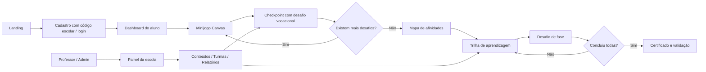

# Arquitetura técnica

## Stack

- **Backend**: Laravel 13 (PHP 8.3+), rotas web, controllers MVC, serviços de domínio, validação com Form Requests inline, Eloquent ORM e transações.
- **Banco**: MySQL 8+ com InnoDB, índices, integridade referencial e JSON para pesos do quiz/opções de fases.
- **Frontend**: Blade SSR, CSS responsivo e JavaScript sem dependências de frameworks de interface; Canvas 2D para o minijogo.
- **Identidade visual**: azul-marinho `#162c51`, verde `#51ba42`, branco `#ffffff`.
- **Autorização**: guard de sessão do Laravel, CSRF, hashing da senha, middleware `role`, controle de escola nos controllers.

## Fluxo de navegação

## Segurança e privacidade

1. Toda resposta de quiz passa por `CareerGameService` que valida `attempt_id`, `question_id`, `answer_id`, ordem e propriedade da conta.
2. Toda conclusão de fase passa por `StageService` e verifica a matrícula, a sequência, a resposta e a condição de conclusão no servidor.
3. Sessão com regeneração no login e logout; senha hasheada; CSRF para alterações; limite de tentativas no login e nas rotas de jogo.
4. O professor só pode editar trilhas próprias da sua escola; usuários criados publicamente sempre recebem `role=student`.
5. Certificado verificável sem revelar nome completo ao público (apenas iniciais na verificação).
6. Para uso com adolescentes, implementar termo institucional de privacidade, definição de base legal e governança escolar, política de retenção, canais de exclusão e autorização dos responsáveis quando cabível. O checkbox atual serve como aviso, não substitui adequação à LGPD.
7. Não disponibilize as credenciais de demonstração em produção. Configure HTTPS, `APP_DEBUG=false`, `SESSION_SECURE_COOKIE=true`, rotinas de backup e envio seguro de e-mail.

## Limites atuais e melhorias recomendadas

- O certificado é um documento HTML próprio para impressão/exportação em PDF pelo navegador. Não há assinatura digital qualificada.
- As reflexões de projetos são registradas, mas não exigem correção docente: a certificação é de **participação**, não de proficiência.
- As afinidades resultam de pesos educacionais editáveis; **não são** avaliação psicométrica validada.
- A ordem de perguntas é congelada por partida, mas o texto/alternativas podem ser atualizados pelo administrador; em produção recomenda-se versionar integralmente o banco de desafios.
- Em uma implantação oficial, adicionar verificação de e-mail, recuperação de senha, logs de auditoria, autenticação com SSO da escola, testes end-to-end e integrações LMS/LTI.
- O jogo oferece uma alternativa acessível para responder missões sem precisar usar os controles de plataforma. O jogo é totalmente original e inspirado no gênero plataforma, não usa personagens, gráficos ou marcas de jogos comerciais.
