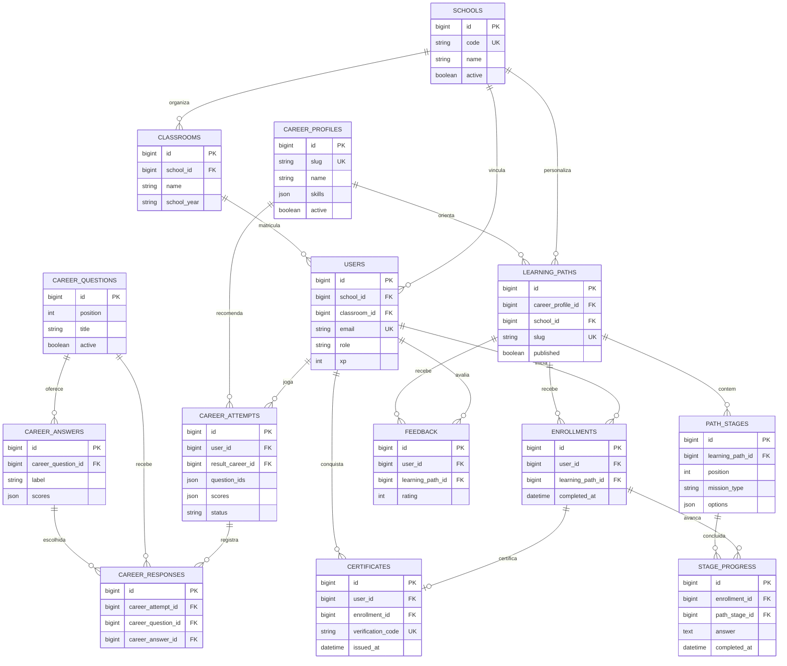

# Diagrama entidade-relacionamento — Rota Tech

As relações são implementadas por **foreign keys** nas migrations Laravel e no arquivo `database/schema_mysql.sql`. O conteúdo dos cursos e as escolhas do quiz são persistidos e administráveis, e a segregação institucional ocorre por `school_id`.

## Principais regras

- Um aluno pertence a uma escola e pode ser associado a uma turma.
- As perguntas guardam as opções e os pesos de afinidade para cada carreira em JSON. A seleção é calculada no servidor.
- Uma partida registra a ordem das perguntas quando começa (`question_ids`), evitando que reordenação posterior mude a sequência.
- Uma matrícula é exclusiva por `user_id` e `learning_path_id`.
- A fase só pode ser concluída se for a próxima fase desbloqueada e a resposta passar na validação do Laravel.
- Só se emite certificado quando todas as fases estão concluídas.
- Professores administram turmas e trilhas da própria escola. O administrador gerencia os catálogos globais.
